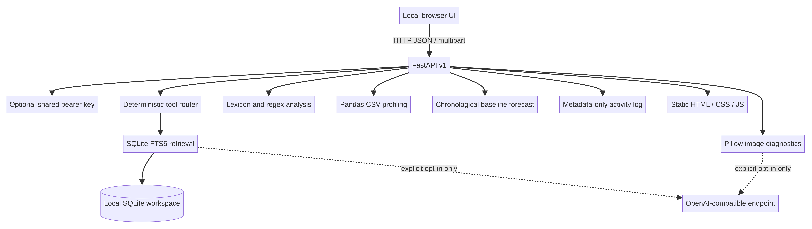

# Skyle AI — local-first AI workbench

Skyle AI is the flagship portfolio platform: a polished local web workbench over a small FastAPI service layer. It brings together document retrieval, text analysis, data profiling, time-series baselines, image diagnostics and transparent tool routing in one interface. It is designed to run without an API key or networked model by default.

> **Honest capability statement:** this first release is a functioning multi-tool prototype, not a trained foundation model or a production SaaS. The agent-style router uses explicit rules; retrieval is lexical; text and image analysis use lightweight local methods. Tests verify software behavior, not general AI quality. The existing portfolio projects remain separate packages and are not yet runtime-connected to Skyle.

## What works locally

| Capability | Local implementation | What it does not claim |
|---|---|---|
| Knowledge / RAG | TXT, Markdown, text-layer PDF and DOCX ingestion; overlapping chunks; SQLite FTS5 retrieval; source passage IDs; delete and clear | No vector embeddings, semantic similarity, OCR, ACLs or large-scale retrieval |
| Agent-style chat | Deterministic routing to local text or knowledge tools; visible route and step trace | Not an autonomous LLM planner or multi-agent team |
| NLP | English and Amharic-script word-list sentiment hints, keywords, URL/email/date/phrase patterns | No fine-tuned model; lexicons and entity patterns are unvalidated and unbenchmarked |
| Data analysis | In-memory pandas CSV profile with missingness, duplicates, numeric summaries and Pearson correlations | No causal/inferential claims; rows are not persisted |
| Forecasting | Last-value and linear-trend candidates; chronological holdout MAE/RMSE; short forecast horizon | No seasonality, intervals or profitability/predictive-accuracy claim |
| Vision | Pillow-based image properties, luminance, contrast and dominant color palette | No local object recognition, OCR, face or scene understanding |
| LLM integration | Optional OpenAI-compatible text and multimodal endpoint adapter; citation-ID gate for RAG | Disabled by default; external endpoint behavior depends on the configured provider/model |



## Run the workbench

Python 3.10+ is required. From this directory, install the locked development/test dependencies and launch on loopback:

```bash
uv sync --locked --extra test
uv run skyle-ai serve
```

Open <http://127.0.0.1:8000>. The first visit can load two original fictional demo documents. Search for “Where is document text stored?” to verify a citation, then try the Text lab, Data studio, Forecasting or Vision modules. CSV rows and images are handled in memory; indexed document text remains in the local SQLite file at `.skyle-data/skyle.sqlite3` until deleted or cleared.

Alternatively, use pip:

```bash
python -m venv .venv
source .venv/bin/activate
python -m pip install -e '.[test]'
skyle-ai serve
```

The server binds to `127.0.0.1` by default. Do not expose it to a public or untrusted network without a trusted gateway and additional security controls.

## Optional authentication and LLM endpoint

A single shared bearer key can protect every `/api/v1` route. The landing page and `/health` remain public. The browser asks once per tab and keeps the key only in session storage.

```bash
export SKYLE_API_KEY='replace-with-a-long-random-value'
```

LLM integration is **off by default**. To opt in, configure an OpenAI-compatible chat-completions endpoint and explicitly enable it:

```bash
export SKYLE_LLM_ENABLED=true
export SKYLE_LLM_BASE_URL='https://api.openai.com/v1'
export SKYLE_LLM_MODEL='your-supported-model'
export SKYLE_LLM_API_KEY='your-key'
uv run skyle-ai serve
```

The configured service receives a question and retrieved source excerpts for generated document answers. The multimodal vision route also sends the selected image when that endpoint is enabled. Only a best-effort source-ID check is applied; it does not prove factual entailment. Confirm that the endpoint’s data-handling terms are acceptable before sending private content. For a local OpenAI-compatible server, use its local base URL and the model it serves. The example environment file is `.env.example`; the app does not load it automatically.

## API

Interactive OpenAPI docs are at <http://127.0.0.1:8000/docs>. Key routes:

| Route | Purpose |
|---|---|
| `GET /health` | Service liveness |
| `GET /api/v1/system` and `/capabilities` | State, configured integrations, methods and boundaries |
| `POST /api/v1/documents/upload` and `/demo/load` | Add a local document or fictional sample |
| `POST /api/v1/ask` and `/chat` | Retrieve cited passages or inspect deterministic tool routing |
| `POST /api/v1/analyze/text` | Local text heuristics |
| `POST /api/v1/analyze/csv` | CSV profile via multipart upload |
| `POST /api/v1/forecast` | Forecast from multipart CSV, with selected value/date columns |
| `POST /api/v1/vision` | Local image diagnostics; optional external multimodal call |
| `GET /api/v1/activity` | Recent metadata-only tool activity |
| `DELETE /api/v1/documents/{id}` or `/documents` | Remove one document or clear the index |

Example source-grounded request:

```bash
curl -X POST http://127.0.0.1:8000/api/v1/ask \
  -H 'Content-Type: application/json' \
  -d '{"question":"Where is document text stored?","top_k":4}'
```

If `SKYLE_API_KEY` is set, also pass `-H 'Authorization: Bearer …'`. Full request/response examples and route details are in [`docs/API.md`](docs/API.md).

## Architecture and engineering choices

The browser calls a versioned FastAPI API. A small deterministic orchestrator selects from a transparent tool set. Persistent document metadata and chunks live in SQLite; FTS5 provides exact lexical retrieval, and source IDs are attached to the returned excerpts rather than invented by a model. Text, CSV and image services are pure local routines. Forecasting uses the first ~80% of the time-ordered observations for fitting, evaluates on the remaining observations, selects by holdout MAE, then refits the selected baseline on the full series for the displayed horizon.

Request logs include request IDs, route, status and duration but omit bodies and query strings. The separate activity store records operation names, aggregate counts, selected route and measured duration, not raw prompt or file content. Upload sizes and row/image dimensions are bounded. UI assets and the fictional examples are bundled in the Python package so the wheel can serve them after installation.

See [`docs/architecture.mmd`](docs/architecture.mmd) for the diagram source and [`docs/quality-and-limitations.md`](docs/quality-and-limitations.md) for the detailed capability, safety and privacy boundaries.

## Tests and checks

```bash
uv run pytest
uv run ruff check src tests
uv run python -m compileall -q src tests
uv build
```

The tests use an isolated temporary SQLite database and generated CSV/image fixtures. They cover auth, upload validation, retrieval/source IDs, deletion, no-evidence behavior, text analysis, activity redaction, chronological forecasting, image measurement and the explicitly mocked LLM citation gate. They use no real user files or external API keys.

Local verification on 2026-11-03: **22 tests passed** (one upstream Starlette/httpx `TestClient` deprecation warning, no failures); Ruff, format, Python compile and JavaScript syntax checks passed; the wheel and source distribution built. A real loopback run served the UI, CSS and JavaScript and exercised sample indexing, cited retrieval, tool routing, text, CSV, forecasting, image diagnostics and activity. The fictional sample index contained 2 documents and 3 passages. The [live-smoke record](docs/live-smoke.json) contains details; it is an implementation smoke test, not an AI quality benchmark.

## Container path

A loopback-only Compose service and Dockerfile are provided:

```bash
cp .env.example .env  # edit only if you explicitly want a shared key or LLM
docker compose up --build
```

The host port is bound to `127.0.0.1:8000`, and the SQLite state is stored in a named volume. Container build/run remains an optional path and must be verified on a machine with Docker before being considered tested. No hosted deployment is configured.

## Portfolio integration and release status

Skyle draws on engineering patterns from the local projects `../ai-document-qa`, `../open_research_agent`, `../multi-agent-research-system`, `../ai-news-intelligence` and `../end-to-end-ml-platform`. It does not import or start those services in this release; dependency-heavy adapters, model serving and cross-project authentication are deliberate future integration work. Source is public at [bereket-web/skyle-ai](https://github.com/bereket-web/skyle-ai) on `main`. The workbench remains local-only: no hosted demo, trained model, external dataset or Hugging Face artifact is published.

Original source code and fictional sample documents are MIT licensed. No external dataset, private data, pretrained model weights or project-scoped Hugging Face credentials are redistributed here.
